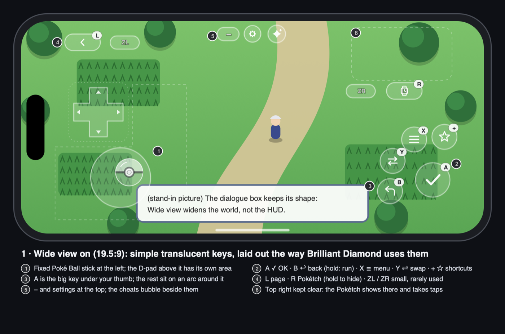

# LumiOS Platinum

**Pokémon Luminescent Platinum on iPhone, running natively.**

LumiOS Platinum packs [Luminescent Platinum](https://luminescent.team) (Team Luminescent's romhack of Pokémon Brilliant Diamond) into an iPhone app. The game's own ARM64 code runs directly on the iPhone's CPU, and its graphics are translated to Metal. There is no emulator in between. It is built on [nxnative](https://github.com/seedds/nxnative).

> **You need your own copies.** This repository holds no game files, mod files, keys or firmware. You build the app yourself from your own dump of Pokémon Brilliant Diamond (update 1.3.0), your own `prod.keys`, and the Luminescent Platinum 2.2F release you downloaded. LumiOS Platinum is a fan project. It is not affiliated with or endorsed by Nintendo, The Pokémon Company, Game Freak, ILCA or Team Luminescent.



## Features

- **Luminescent Platinum 2.2F, whole.** Both halves of the mod are included. The `exefs` half (an IPS patch to `main` and the exlaunch plugin `subsdk1`) is applied when the app is built. The `romfs` half is laid over the game's files. iOS never has to change code while the game runs.
- **Brilliant touch layout.** These touch controls follow how Brilliant Diamond uses its buttons. The keys are translucent and colourless, with no text: each shows a symbol and a small button mark at its corner.
  - A (✓) is the large key under your right thumb. B (↩), Y (⇄), X (☰) and + (☆, your registered key items) sit on an arc around it.
  - The left stick is a fixed Poké Ball near the left edge: touch anywhere in its area and tilt from its centre. The D-pad above it has its own touch area, so the stick never presses it.
  - The top-right corner stays free, because the Pokétch shows there and you can tap it directly.
- **Wide view (19.5:9).** The game renders the iPhone's full screen width itself. Nothing is stretched: models and the HUD keep their shapes. You can turn it off in the launcher to get 16:9 with bars.
- **Cheats bubble.** A draggable button opens a panel of cheats while you play. Turn it on in the launcher. The cheat engine and the panel are in place, but the list of tested cheats is still to come.
- **60 fps**, or 30 if you prefer: the Frame rate setting in the launcher.
- **A repaired Luminescent file.** Luminescent 2.2F ships one Giratina texture bundle (`pokemons/common/pm0487_12_00`) with a broken block table, which no reader can open. The build repairs it in the app's copy of the game files and leaves your download untouched.

## Requirements

- **iPhone:** A17 Pro chip or later (iPhone 15 Pro and newer), iOS 26 or later. The game's textures are BC-compressed, and older iPhones cannot read them. Converting them to ASTC for older phones is on the roadmap.
- **Mac:** Apple silicon, macOS 26.6 or later, [Xcode 27.2](https://developer.apple.com/download/all/?q=Xcode%2027.2) with its iOS platform, [Homebrew](https://brew.sh) (`xcodegen`, `zstd`) and Python 3.12 or newer with `lz4`, `capstone` 5, `fonttools` and `zbic`.
- **Files:** Pokémon Brilliant Diamond, base game plus update 1.3.0, as NSPs; `prod.keys`; Luminescent Platinum 2.2F for Brilliant Diamond (the folder with `exefs/` and `romfs/`).
- **Disk:** about 25 GB free while building. The finished IPA is about 4.7 GB.

## Build

Put the two NSPs and `prod.keys` in one folder (called `GAME` below). Then:

```bash
python3 scripts/build_ipa_from_nsp.py GAME -k GAME/prod.keys --platform mac
```

This extracts Brilliant Diamond into `GAME/0100000011D90000_build`. Next, lay Luminescent Platinum over the extracted game:

```bash
python3 scripts/prepare_mod.py GAME/0100000011D90000_build "path/to/Luminescent Platinum 2.2F BD" GAME/0100000011D90000_lumi --compact
```

Then build the IPA from the modded game:

```bash
python3 scripts/build_ipa_from_nsp.py GAME -k GAME/prod.keys --work-dir GAME/0100000011D90000_lumi --app-name "Pokemon Luminescent Platinum" --icon icon.png -o LumiOS-Platinum.ipa
```

To check the modded game on the Mac first, run the same command with `--platform mac` instead of `-o …`. Its last line is the command that starts the game.

## Install

The IPA is unsigned. Install it with a sideloading tool such as AltStore, Sideloadly or LiveContainer. If your tool offers **Increased Memory Limit**, turn it on. When something goes wrong, the app's log is `Documents/log.txt`, which you can reach through the Files app.

## Launcher settings

| Setting | Default | What it does |
|---|---|---|
| Frame rate | 60 fps | 30 or 60 |
| Wide view | On | The iPhone's full width (19.5:9), or Off for 16:9 with bars |
| Cheats | Off | Shows the cheats bubble in the game |
| Console mode | Handheld | Docked renders more pixels: sharper, but more work for the phone |

The other rows (upscaling, render options, rumble) come from nxnative.

## Status

- **Mac:** boots to Luminescent's language screen and through Rowan's introduction, at 60 fps with no errors. Wide view is checked there: the picture is 2.17:1, and Rowan and the dialogue box keep their proportions. In this scene the game's camera trims the top and bottom rather than showing more at the sides.
- **iPhone:** built, but not yet played on a phone.
- **Brilliant Diamond's known issue:** physics problems above 30 fps have been reported on this game build. If movement looks wrong, set Frame rate to 30.

## Roadmap

- A tested cheat list for the cheats bubble: data cheats first (money, items), then hooks for behaviour cheats.
- Lower memory use, for the phones with the least to spare.
- Older iPhones (A15 / A16): convert the game's BC textures to ASTC when the app is built.

## How it works

- `scripts/prepare_mod.py` applies the mod. It patches `main` with the IPS (the module keeps its build ID), adds `subsdk1`, and writes a RomFS image with Luminescent's files in place. It also repairs a Unity bundle whose block table doesn't match its compressed blocks.
- **`module_at`** (`dm/host/loader.c`): on the Switch, `subsdk1` sits at `main` + 0x5708000. It calls into `main` 1,228 times, and `main`'s patches branch back into it. So the loader places it at exactly that distance.
- **Wide view** (`dm/tools/unity_fps.py`, `dm/host/hle_fpslock.c`): the build finds Unity's screen manager. While the game runs, the host asks Unity for the game's width at the screen's shape (1280x590 handheld, 1920x886 docked). Unity then sizes its cameras and HUD itself, and the presenter shows that crop in its own shape.
- The touch layout is in `dm/ios/Sources/DmGamepad.m`. The cheats bubble is in `dm/ios/Sources/DmCheats.m`.

nxnative's own documentation is in [NXNATIVE.md](NXNATIVE.md) (supported games, building) and [docs/development.md](docs/development.md) (internals). The guides for working on the engine are in [docs/agents](docs/agents/README.md).

## Acknowledgements and credits

LumiOS Platinum is a thin layer over other people's work.

**The game and the mod**
- **Pokémon Brilliant Diamond:** Nintendo, The Pokémon Company, Game Freak and ILCA. Pokémon and its names are trademarks of their owners.
- **[Luminescent Platinum](https://luminescent.team):** Team Luminescent (BSD 3-Clause), the romhack this app runs.
- **Renegade Platinum:** by Drayano, the design Luminescent Platinum is built on. Their code is based on [exlaunch](https://github.com/shadowninja108/exlaunch) by shadowninja108 (GPLv2) and [scarlet-exlaunch-base](https://github.com/craftyboss/scarlet-exlaunch-base) by craftyboss (GPLv2). None of their files are in this repository: you supply them.
- **App icon:** uses Luminescent Platinum's logo and Giratina artwork, credited to Team Luminescent and the artwork's creators.

**The engine**
- **[nxnative](https://github.com/seedds/nxnative)** by seedds (MIT). It runs Switch games natively on Apple platforms: the NSO rewriter, the Horizon host, NVN on Metal, the iOS app and launcher, the shader pipeline, the cheat engine, and the Brilliant Diamond 1.3.0 port this project starts from.
- **nxnative's Brilliant Diamond contributors:** widestorm ([PR #190](https://github.com/seedds/nxnative/pull/190), the first Brilliant Diamond port); itsrenoria ([PR #997](https://github.com/seedds/nxnative/pull/997)); the iPhone Duo, portrait and iPad layouts ([PR #683](https://github.com/seedds/nxnative/pull/683)); and iediot's mods work ([PR #883](https://github.com/seedds/nxnative/pull/883)), which showed the way for packing mods.
- **What nxnative builds on** (licenses in [dm/third_party](dm/third_party/README.md)):
  - [d2r-mobile](https://github.com/jhaizhou-ops/d2r-mobile) (MIT): the native-execution approach, and where nxnative's code started.
  - Ryujinx (MIT): its shader translator.
  - [Atmosphère](https://github.com/Atmosphere-NX/Atmosphere): its kernel is nxnative's reference for Horizon's semantics. This project also follows its formats for the IPS patch, the `exefs`/`romfs` mod layout and its cheat VM.
  - [LibHac](https://github.com/Thealexbarney/LibHac): reads the NSPs.
  - [SPIRV-Cross](https://github.com/KhronosGroup/SPIRV-Cross) and [glslang](https://github.com/KhronosGroup/glslang).
  - [MacNativeGames](https://github.com/ly05010419/MacNativeGames) (MIT).
- **[AssetRipper's type tree dumps](https://github.com/AssetRipper/TypeTreeDumps):** the Unity 2019.4 layouts nxnative's bundle reader uses.

**Tools and libraries**
- Apple's Xcode, Metal, MetalFX and SF Symbols (the touch layout's and the cheats panel's symbols).
- [xcodegen](https://github.com/yonaskolb/XcodeGen) and [zstd](https://github.com/facebook/zstd).
- [python-lz4](https://github.com/python-lz4/python-lz4), [Capstone](https://www.capstone-engine.org), [fontTools](https://github.com/fonttools/fonttools) and zbic.

**References**
- Brilliant Diamond's controls, used to lay out the touch keys, came from [Bulbapedia](https://bulbapedia.bulbagarden.net), [Serebii](https://serebii.net/brilliantdiamondshiningpearl/poketch.shtml) and [Gamer Guides](https://www.gamerguides.com/pokemon-brilliant-diamond-and-shining-pearl).

**This project**
- LumiOS Platinum by [cheemu21](https://github.com/cheemu21), built with the help of Claude Code (Anthropic).

## License

The code is MIT, like nxnative's ([LICENSE](LICENSE), © seedds). Third-party code keeps its own license ([dm/third_party](dm/third_party/README.md)). Luminescent Platinum, Pokémon Brilliant Diamond and their assets belong to their owners and are not covered by this license.
